# MLM Software


A full-featured **binary MLM (network marketing) platform** — rebuilt from a legacy CodeIgniter 2.x codebase into a modern **Laravel 13** application with a JSON API, a Blade + Tailwind dashboard, and a fully tested business-logic layer.

**Admin:** `admin@mlm.local` / `password` · **Web app:** `http://localhost` · **API:** `/api/v1`

---

## Tech Stack

| Layer      | Technology                                        |
| ---------- | ------------------------------------------------- |
| Backend    | Laravel 13, PHP 8.3                               |
| Frontend   | Blade, Alpine.js, Tailwind CSS 4                  |
| Database   | MySQL 8.0 (in-memory SQLite for tests)            |
| Auth       | Laravel Sanctum (API tokens) + Spatie Permissions |
| Queue      | Database driver (Redis available via Compose)     |
| Exports    | DomPDF, CSV streaming                             |
| Testing    | PHPUnit 12 — **127 tests, 355 assertions**        |
| Containers | Docker + Docker Compose                           |

---

## Features

- **Binary MLM tree** — left/right leg placement, auto-balancing, materialized-path storage, downline + leg-volume reports
- **Commission engine** — sponsor bonus (10%), matching bonus on the weaker leg, 7-level commissions, royalty placeholder
- **CV system** — 7 purchase tiers, bank/wallet payments, PIN-based activation, CV history
- **PIN management** — generate, assign, validate and expire activation PINs
- **Wallet & withdrawals** — credit/debit/hold/release, withdrawal fee, KYC-gated requests, admin approval
- **Monthly interest** — configurable rate auto-credited against active CV
- **KYC workflow** — document upload, admin review, multi-document status
- **Roles & permissions** — admin / agent / member (Spatie)
- **Support tickets** — member submissions, admin replies, priority & status tracking
- **Reports & exports** — earnings, downline, commissions, withdrawals (CSV / PDF)
- **Audit trail** — every critical action logged with subject and before/after values
- **Dockerized** — PHP-FPM + Nginx + MySQL + Redis via Docker Compose

---

## Screenshots

### Login & Dashboard

| | |
| --- | --- |
| 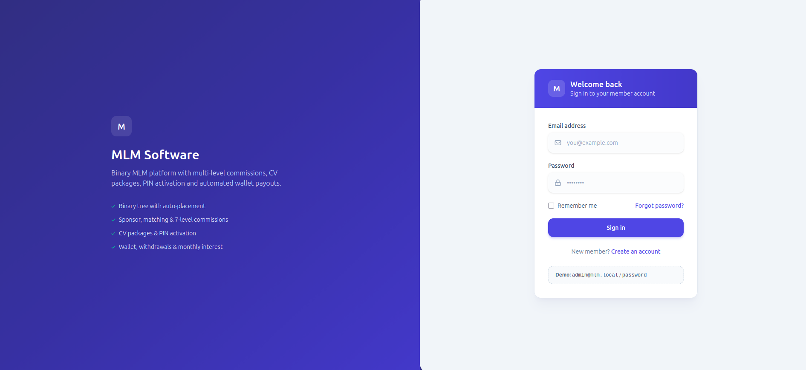 | 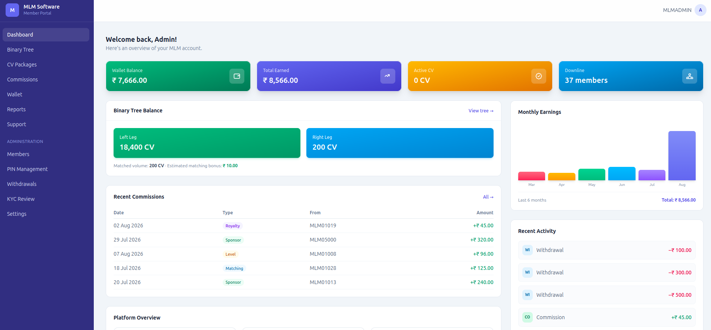 |

### Member Features

| | |
| --- | --- |
| 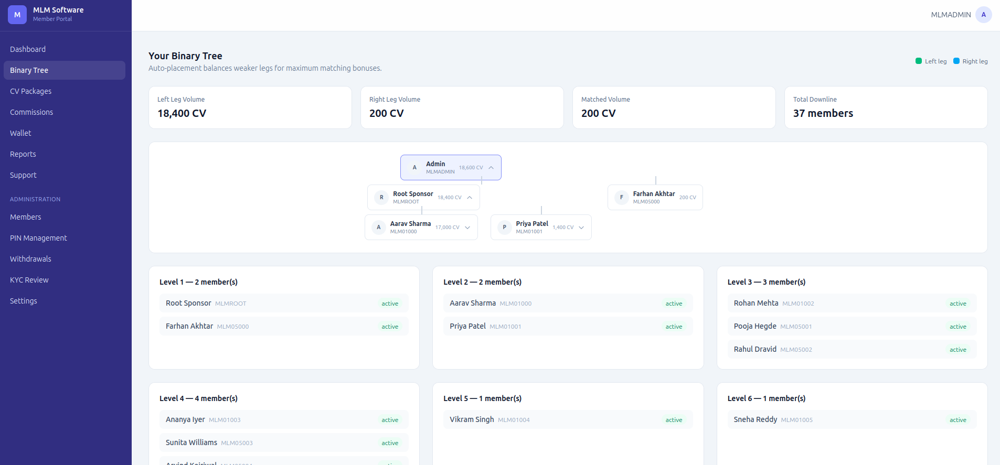 | 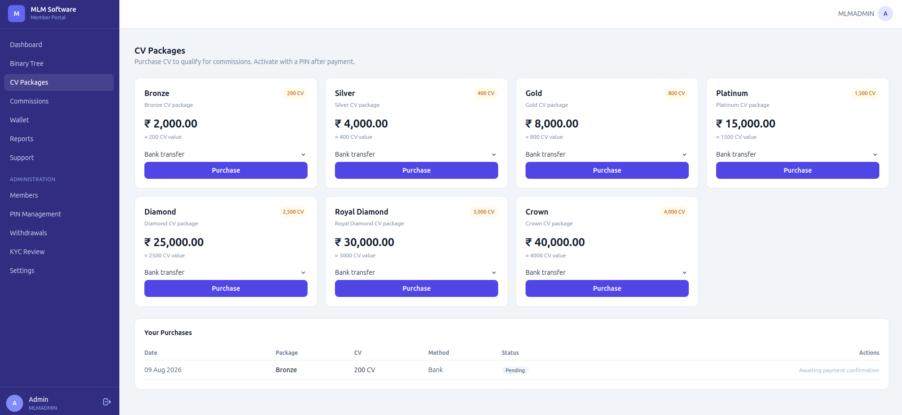 |
| 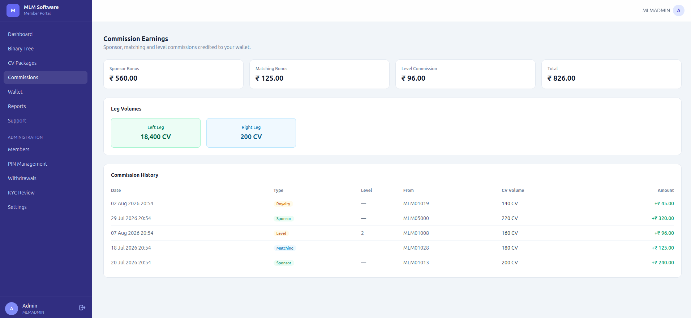 | 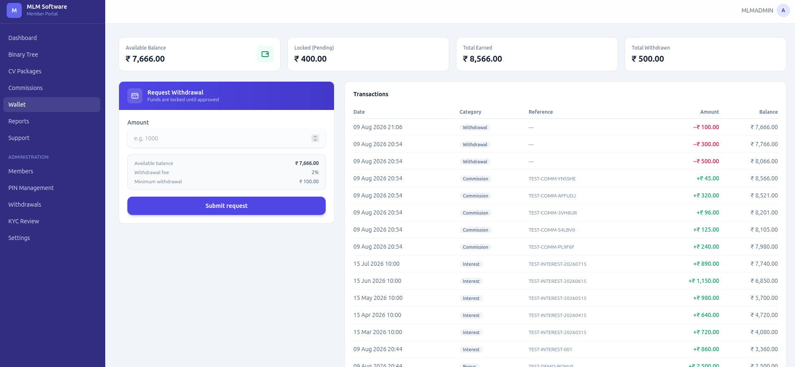 |
| 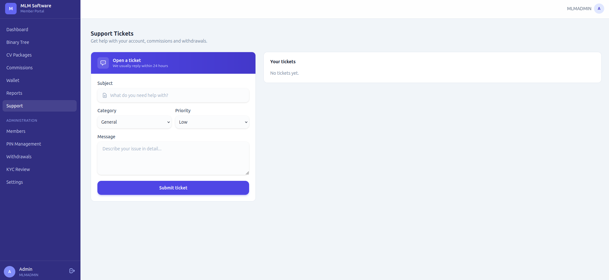 | 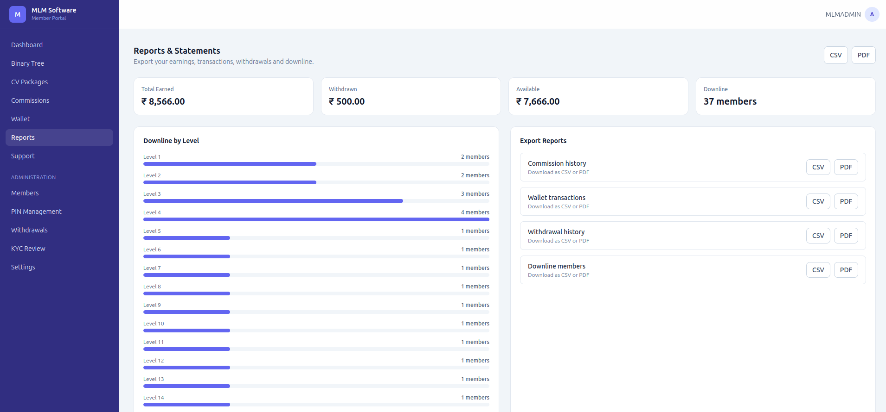 |

### Admin Panel

| | |
| --- | --- |
| 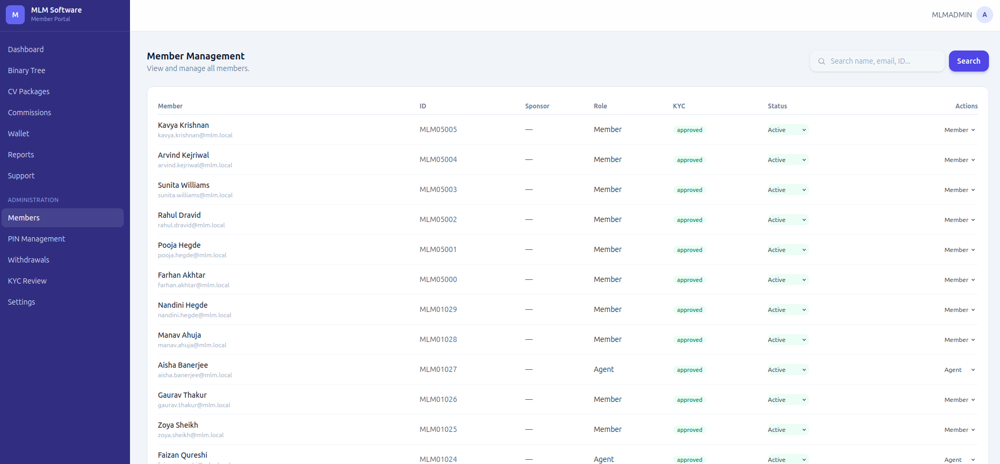 | 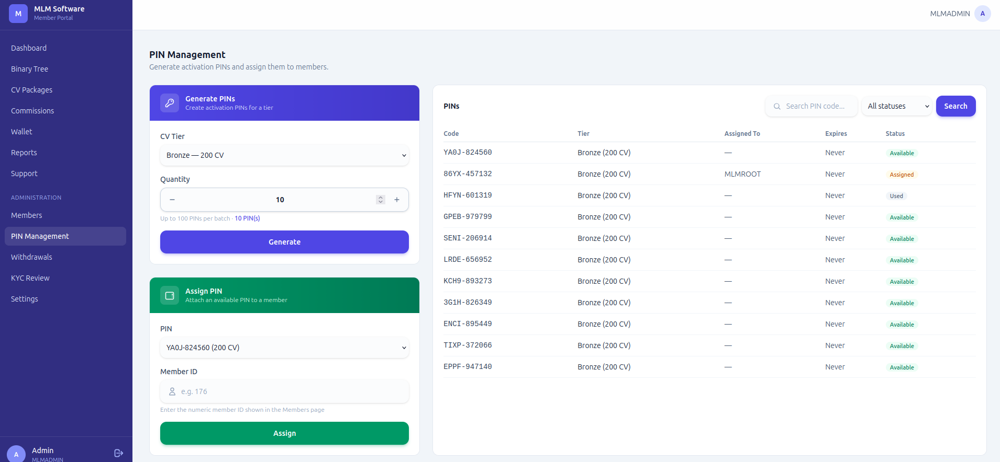 |
| 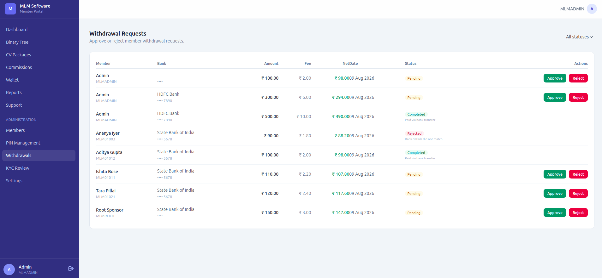 | 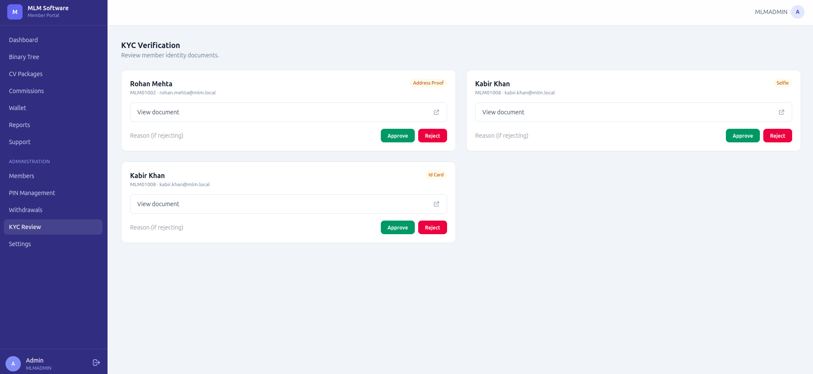 |
| 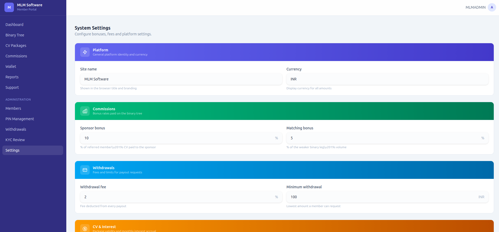 | 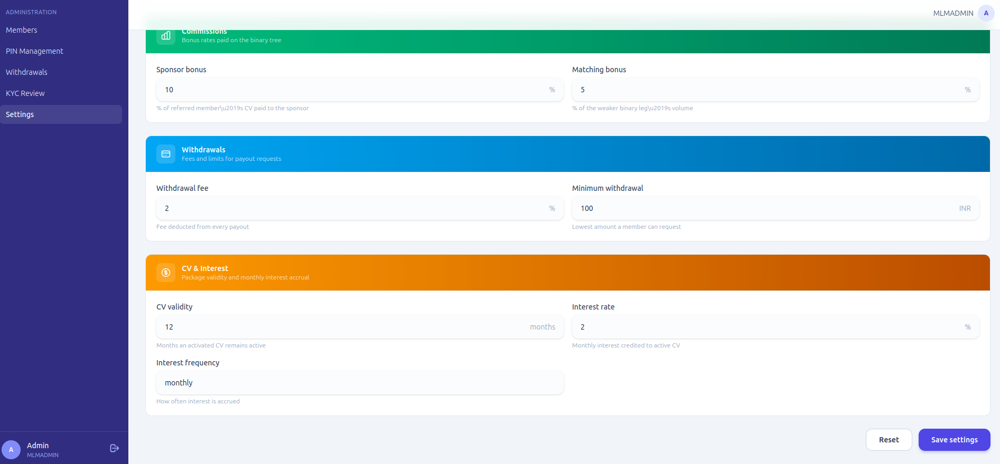 |

---

## Quick Start

### Docker (recommended)

```bash
cp .env.example .env
# generate an APP_KEY (php artisan key:generate) and keep the DB defaults from docker-compose.yml

docker compose up -d --build
docker compose exec app php artisan migrate --seed
```

- App: `http://localhost:80`
- MySQL: `localhost:3307` · Redis: `localhost:6380`
- All artisan / npm commands run inside the container:

```bash
docker compose exec app php artisan db:seed --class=TestDataSeeder
docker compose exec app npm run build
```

### Local

```bash
git clone https://github.com/shaik-obydullah/mlm-software.git
cd mlm-software

composer install
cp .env.example .env
php artisan key:generate

npm install --ignore-scripts
npm run build

php artisan migrate --seed   # SQLite (quick start) or MySQL (edit .env first)
php artisan serve
```

---

## Demo Data

`php artisan migrate --seed` runs `DatabaseSeeder` (roles, CV tiers, commission rules, system config + `DemoDataSeeder`), which creates an admin, a root sponsor and 30 members with activated CVs and commissions.

| Role  | Email             | Password   |
| ----- | ----------------- | ---------- |
| Admin | `admin@mlm.local` | `password` |
| Root  | `root@mlm.local`  | `password` |

A separate idempotent `TestDataSeeder` adds realistic activity (withdrawals, tickets, KYC docs, PINs, backdated interest):

```bash
docker compose exec app php artisan db:seed --class=TestDataSeeder
```

---

## Web Dashboard

Member-facing routes (authenticated):

| Route        | Description                          |
| ------------ | ------------------------------------ |
| `/dashboard` | Stats, earnings chart, activity feed |
| `/tree`      | Binary tree visualization            |
| `/cv`        | CV tiers, purchases & activation     |
| `/commissions` | Commission history                  |
| `/wallet`    | Balance, transactions, withdrawals   |
| `/tickets`   | Support tickets + replies            |
| `/reports`   | Earnings / downline / exports        |
| `/profile`   | Personal, bank & KYC details         |

Admin routes (role: `admin`) — `/admin/users`, `/admin/pins`, `/admin/withdrawals`, `/admin/kyc`, `/admin/settings`.

---

## API Overview

All endpoints live under `/api/v1` and use Bearer-token auth (Sanctum).

```
POST  /api/v1/register                Register a member (optional sponsor_unique_id)
POST  /api/v1/login                   Login and receive a token
POST  /api/v1/logout                  Revoke current token
GET   /api/v1/user                    Authenticated profile

GET   /api/v1/users                   List users (permission: view users)
GET   /api/v1/users/{id}              User detail

GET   /api/v1/mlm/tree/{userId}       Binary tree (depth param)
GET   /api/v1/mlm/downline/{userId}   Downline + leg volumes
POST  /api/v1/mlm/place               Manual placement (admin)

GET   /api/v1/cv/tiers                Active CV tiers
POST  /api/v1/cv/purchase             Create purchase (bank|wallet)
POST  /api/v1/cv/{id}/pay             Mark paid (permission: approve payments)
POST  /api/v1/cv/{id}/activate        Activate (optional pin_code)

POST  /api/v1/pins/generate           Generate PINs (permission: manage pins)
POST  /api/v1/pins/assign             Assign PIN to member
POST  /api/v1/pins/use                Validate a PIN

GET   /api/v1/commissions/rules       Commission rules
POST  /api/v1/commissions/process     Process commissions (permission)

GET   /api/v1/wallet/balance          Balance summary
GET   /api/v1/wallet/transactions     Filter by category/type
POST  /api/v1/withdrawal/request      Request withdrawal (KYC required)
POST  /api/v1/withdrawal/{id}/approve Approve (permission)

POST  /api/v1/kyc/upload              Upload KYC document
GET   /api/v1/kyc/documents           Own documents (or all for admin)
POST  /api/v1/kyc/{id}/review         Review (permission: review kyc)

GET   /api/v1/reports/earnings        Earnings summary (+ platform totals for admin)
GET   /api/v1/reports/downline        Downline statistics
GET   /api/v1/reports/export/{type}   Export CSV (commissions|transactions|withdrawals|downline)

GET/POST/PATCH /api/v1/tickets        Support tickets + replies
```

---

## Commission Model

| Type             | Calculation                                  |
| ---------------- | -------------------------------------------- |
| Sponsor bonus    | 10% of the referred member's CV amount       |
| Matching bonus   | 5% of the weaker binary leg's volume         |
| Level commission | 5/4/3/2/2/2/2% across 7 upline levels       |
| Royalty bonus    | Placeholder — scheduled monthly pool payout  |

`app/Services/CommissionService.php` credits these when a CV purchase is activated; every credit is written to the wallet with a matching audit-log entry.

---

## Project Structure

```
app/
├── Enums/                       Domain status enums
├── Http/Controllers/{Api,Web}/  JSON API + Blade controllers
├── Models/                      Eloquent models (22 tables)
├── Services/                    Business logic: MlmTree, Cv, Pin, Commission, Wallet, Interest, Audit
├── Jobs/                        CalculateCommissions, GeneratePinBatch, ProcessInterestAccrual
└── helpers.php                  money() helper

database/
├── migrations/                  24 migrations
├── seeders/                     Role, CvTier, CommissionRule, SystemConfig, DemoData, TestData
└── factories/                   User, Pin, CvTier, CvPurchase, Commission, CvActivation

resources/views/                 Blade + Tailwind 4 + Alpine.js dashboard
routes/                          web.php, api.php
tests/                           127 PHPUnit tests (services + API)
docker/                          nginx.conf, supervisord.conf, php.ini
```

---

## Database Schema

Core tables across the platform's subsystems:

```sql
-- Users & auth
users            (id, sponsor_id, unique_id, name, email, password, phone, role,
                  status, balance, kyc_status, created_at, timestamps)
roles, model_has_roles

-- MLM structure
mlm_trees        (id, user_id, parent_id, position, level, path, timestamps)
sponsors         (id, sponsor_id, sponsee_id, type, timestamps)

-- CV system
cv_tiers         (id, name, amount, description, status, timestamps)
cv_purchases     (id, user_id, tier_id, amount, payment_method, status, transaction_id)
cv_activations   (id, purchase_id, user_id, activation_date, expiry_date, status)

-- PIN system
pins             (id, code, cv_tier_id, created_by, assigned_to, status, expires_at, used_at)

-- Commissions
commission_rules (id, name, type, rate, min_volume, max_level, status)
commissions      (id, user_id, from_user_id, type, amount, status, paid_at)
commission_batches (id, period_start, period_end, total_amount, status, processed_by)

-- Funds
wallets          (id, user_id, balance, locked_amount)
transactions     (id, wallet_id, type, amount, reference, status)
withdrawal_requests (id, user_id, amount, fee, net_amount, method, bank_name,
                     account_number, status, approved_by)

-- Interest
interest_rates   (id, rate, effective_date, status)
interest_accruals (id, user_id, cv_purchase_id, amount, rate, period, status)

-- KYC
kyc_documents    (id, user_id, type, file_path, status, reviewed_by)

-- Support
tickets          (id, user_id, subject, priority, status)
ticket_replies   (id, ticket_id, user_id, message)

-- Platform
settings         (id, key, value, group)
audit_logs       (id, user_id, action, subject_type, subject_id, old_values, new_values)
```

---

## Testing

```bash
docker compose exec app php artisan test   # or: composer test
docker compose exec app vendor/bin/pint --test   # code style
```

The suite runs against in-memory SQLite by default (`phpunit.xml`).

---

## License

MIT
